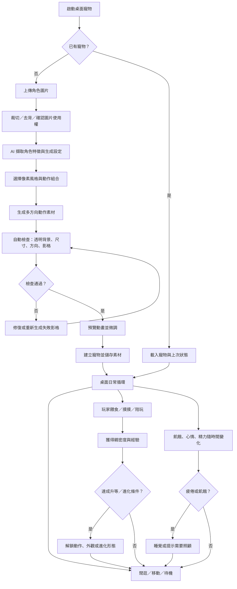
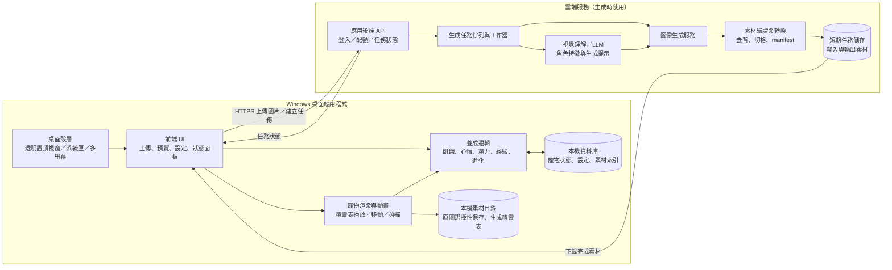

# 桌面寵物：開發流程、技術可行性與程式架構

> 版本：概念規劃初稿（2026-11-08）  
> 目標假設：先做 Windows 桌面版；使用者上傳一張角色圖片，生成可在桌面活動的像素寵物。

## 1. 產品目標與範圍

核心體驗是「把喜歡的角色帶到桌面上養」。使用者上傳角色圖片，AI 協助轉成 16-bit 像素角色與動作素材；寵物會在桌面上自由漫遊或固定位置，之後再加入餵食、喝水、看醫生、心情和成長玩法。

**目前里程碑只製作介面原型。**收起時桌面上只顯示灰色像素蛋與問號；右鍵展開照顧面板。照顧數值、角色生成、寵物移動 AI 和養成邏輯均暫不實作，詳見 [介面原型規格](ui-prototype-spec.md)。

第一版建議先驗證三件事：

1. 桌面寵物是否能穩定顯示、移動和接受滑鼠互動。
2. 上傳圖片能否轉成外觀一致、可用的像素角色素材。
3. 餵食、陪玩、休息是否構成有趣且不打擾工作的日常循環。

## 2. 使用者開發流程圖

## 3. 技術可行性分析

| 能力 | 可行性 | 難點 | 建議做法 |
|---|---|---|---|
| 透明、置頂、可拖曳的桌面寵物視窗 | 高 | 不同螢幕縮放、多螢幕座標、滑鼠穿透與互動切換 | MVP 聚焦 Windows；桌面寵物視窗與設定視窗分開；先支援單螢幕主要情境 |
| 像素角色生成 | 中高 | 生成模型可能把像素畫成模糊插畫，或改變角色細節 | 生成時明確限制調色盤、輪廓與畫布尺寸；再以最近鄰縮放、色彩量化和輪廓檢查做像素化整理 |
| 同一角色多角度一致 | 中低，是主要風險 | 單張參考圖不足以定義背面與側面；生成時外觀會漂移 | 先產生角色設定表和方向參考圖；採「逐方向生成、逐張驗收」；提供使用者預覽重做，避免一次要求模型生成整張大型精靈表 |
| 多動作動畫素材 | 中 | 每種動作和方向都增加影格數，素材量快速膨脹 | MVP 限定 4 個方向、4 種動作（待機、走路、吃飯、睡覺），每段 4–6 格；玩耍等動作用後續版本擴充 |
| 素材切格與動畫播放 | 高 | 影格尺寸、速度、碰撞區域需一致 | 生成後轉為統一規格的透明 PNG 精靈表或逐格 PNG，附 JSON manifest 描述動作、方向、影格數和速度 |
| 養成狀態與離線時間 | 高 | 關閉程式後狀態要合理推進，避免時間跳躍造成負面體驗 | 本機保存最後活動時間；啟動時按封頂規則計算飢餓、精力與經驗變化 |
| LLM／圖像生成服務串接 | 高 | 延遲、成本、服務商差異、內容審核與隱私 | 後端採 provider adapter；先接單一服務；顯示生成進度與失敗重試；設定圖片保留政策 |
| 個人圖片安全與資料保護 | 高，需產品決策 | 使用者可能上傳私人照片或第三方角色 | 預設僅用於生成；明確告知是否上傳雲端及保存多久；提供刪除圖片/素材；加入內容與版權說明 |

### 生成流程建議

不要把「辨識、設計、所有角度與全部動畫」壓成一次模型呼叫。建議分成可檢查的小步驟：

1. **角色理解**：視覺模型輸出結構化外觀描述（主色、輪廓、配件、不可變特徵）。
2. **角色基準圖**：先產出正面像素角色，讓使用者確認辨識度與像素風格。
3. **方向參考圖**：以基準圖和特徵描述生成側面、背面等方向圖，使用者可逐張修正。
4. **動作影格**：對每個方向生成少量關鍵影格，再補中間影格或使用簡單位移/擺動動畫。
5. **素材正規化**：去除背景、統一畫布與角色錨點、量化色彩、檢查透明度和空白影格，輸出精靈表與 manifest。
6. **預覽驗收**：在桌面寵物實際播放；使用者可重新生成單一方向或動作，無需重做整個角色。

### 主要風險與控制

- **外觀一致性是最大產品風險**：用「逐階段生成 + 使用者驗收 + 局部重做」控制，不承諾任意圖片都能一次產生完美動畫。
- **素材數量與成本**：先限制方向、動作、影格數；只在首次建檔或明確要求時生成，平常播放使用本機素材。
- **桌面干擾感**：提供暫停、縮小、隱藏、勿擾時段和互動頻率設定。
- **生成不可用時仍可玩**：預置一套示範角色；生成失敗不阻止使用者先體驗養成玩法。

## 4. 建議程式架構圖

### 模組責任

- **桌面殼層**：管理透明無邊框視窗、置頂、拖曳、系統匣、開機啟動與視窗座標。
- **寵物渲染器**：根據狀態選擇動作和方向，播放影格並處理桌面上的移動路徑。
- **養成核心**：以純資料規則計算狀態與成長；UI 不直接改寫規則，方便未來調整平衡。
- **本機儲存**：保存玩家狀態和素材索引；敏感原始圖片預設不永久保留。
- **生成後端**：保護服務金鑰、管理生成任務、重試與成本；使用介面隔離不同模型供應商。
- **素材驗證器**：輸出桌面端可直接播放的統一素材規格，避免執行時依賴生成模型。

## 5. 建議技術選型

### 桌面端

- **首選：Tauri 2 + TypeScript 前端 + Rust 桌面層**。適合需要較輕桌面外殼、前端快速迭代並保留原生系統整合的方案。Tauri 使用作業系統 WebView；Windows 使用 WebView2，安裝與部署需把 WebView2 環境納入考量。[Tauri 架構](https://v2.tauri.app/concept/architecture/)、[WebView 版本說明](https://v2.tauri.app/reference/webview-versions/)
- **替代：Electron + TypeScript**。若團隊熟悉 Web/Node，開發迭代直接；Electron 將 Chromium 和 Node.js 隨程式提供，通常會增加發行包體積。[Electron 官方介紹](https://www.electronjs.org/docs/latest/)、[Electron 程序模型](https://www.electronjs.org/docs/latest/tutorial/process-model)
- **動畫顯示**：Canvas 或 DOM 精靈表皆可；像素美術需要關閉平滑插值，按整數倍縮放，並把碰撞/點擊區與可見圖像分開。
- **本機資料**：SQLite 存寵物狀態、設定和素材索引；圖片與精靈表存應用程式資料目錄。

### 後端

- REST/HTTPS API + 背景工作佇列，生成任務以 job ID 非同步輪詢或推送狀態。
- Provider adapter 抽象視覺理解與圖像生成服務，避免桌面程式直接持有模型金鑰。
- 任務輸出先經素材驗證，再由桌面端下載並保存本機；伺服器採短期保存策略。
- MVP 可先不做社群、雲端同步、交易系統與多角色市場。

## 6. 分階段開發路線

| 階段 | 交付內容 | 完成判準 |
|---|---|---|
| 0. 介面原型 | 收起顯示像素蛋；右鍵面板；照顧入口、設定頁、更新頁與退出 | 介面層級清楚，未實作功能明確停用 |
| 1. 桌面寵物 | 像素角色在桌面漫遊或固定、互動區和行為設定 | 不遮擋工作，能拖曳、固定和恢復位置 |
| 2. 養成系統 | 餵食、喝水、看醫生、心情、睡眠和狀態保存 | 各狀態變化合理，低狀態的生病/看診循環完整 |
| 3. 16-bit 角色生成 | 上傳圖片、角色理解、動作與角度素材、預覽和局部重做 | 角色辨識度與動畫一致性通過使用者驗收 |
| 4. 成長與發布 | 經驗、升等、進化、安裝更新與錯誤回報 | 可長時間使用，提供清楚的隱私與圖片刪除控制 |

## 7. MVP 範圍建議

**目前包含**：Windows 透明無邊框桌面視窗、收起時的灰色 16-bit 像素蛋、右鍵展開控制面板、照顧功能介面入口、設定頁（上傳/角色選擇/漫遊或固定）、更新頁與退出。除面板導覽和拖曳外，遊戲與生成按鈕先停用。

**延後**：任意複雜進化樹、多寵物社交、雲端同步、語音互動、玩家自製動畫編輯器、社群分享與商城。

下一階段再驗證寵物在桌面自由移動/固定的互動手感；圖像生成與多角度動畫一致性留到介面確認後再做。
